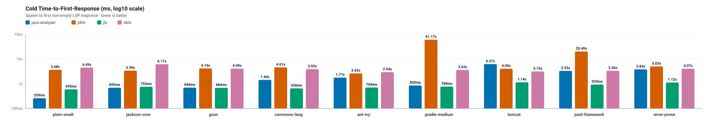
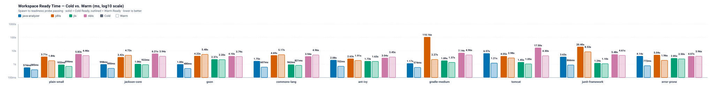
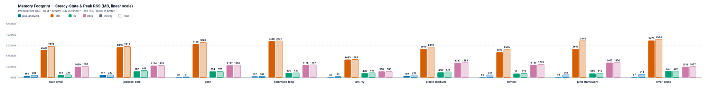
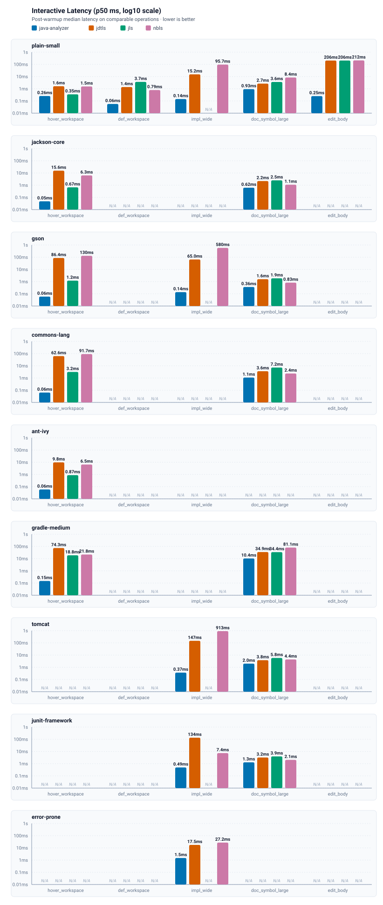

# Java LSP Benchmarks

> [!NOTE]
> **Incomplete Benchmark:** This report reflects a preliminary, incomplete benchmark run. It skips parts of full benchmarking setup (such as OS disk-cache clearing, isolated per-server workspace resets, and build-tool dependency prefetching) as well as some long-running scenarios and unimplemented LSP capabilities; treat numbers as directional rather than a strict apples-to-apples comparison.

## Environment & Revisions

- **OS / Arch**: `macos` / `aarch64`
- **CPU**: Apple M4 Pro (12 cores)
- **RAM**: 24 GB
- **Java**: `openjdk version "27.0.1.0.2" 2026-10-21`
- **Revision**: `rnrqqkwm (d08a31b2, Add bench-plot, CSV/SVG exports, and Vega-Lite HTML report)`
- **Date**: 2026-11-24
- **Servers**:
  - `java-analyzer`: target/release/java-analyzer lsp
  - `jdtls`: target/bench/servers/jdtls/bin/jdtls -data {cache_dir}
  - `jls`: target/bench/servers/jls/extension/dist/lang_server_mac.sh
  - `nbls`: target/bench/servers/nbls/extension/nbcode/bin/nbcode.sh --userdir {cache_dir} --start-java-language-server

## Charts

## Matrix 1 — Lifecycle, First Response, Memory & Reliability

| Repo | Tier | Shape | Files | Server | Cold Init | Cold 1st Resp | Cold Ready | Warm Init | Warm 1st Resp | Warm Ready | Peak RSS | Steady RSS | Error Rate | Clean-File Errors |
| :--- | :--- | :--- | ---: | :--- | ---: | ---: | ---: | ---: | ---: | ---: | ---: | ---: | ---: | ---: |
| `plain-small` | small | plain+single-module | 150 | `java-analyzer` | 21.7ms | 259.4ms | 573.9ms | 5.1ms | 67.9ms | 385.2ms | 219.8 MB | 161.1 MB | 0.0% | 0 |
| `plain-small` | small | plain+single-module | 150 | `jdtls` | 2824.8ms | 3680.0ms | 3709.5ms | 1144.2ms | 1816.9ms | 1839.0ms | 2923.9 MB | 2571.5 MB | 0.0% | 8 |
| `plain-small` | small | plain+single-module | 150 | `jls` | 372.0ms | 592.6ms | 932.0ms | 159.0ms | 349.7ms | 693.6ms | 255.2 MB | 250.7 MB | 0.0% | 0 |
| `plain-small` | small | plain+single-module | 150 | `nbls` | 3985.5ms | 4493.7ms | 5833.7ms | 2677.8ms | 3148.1ms | 4460.9ms | 1056.9 MB | 1020.2 MB | 0.0% | 2 |
| `jackson-core` | small | maven+single-module | 358 | `java-analyzer` | 18.4ms | 691.6ms | 997.9ms | 6.6ms | 179.0ms | 489.5ms | 247.3 MB | 247.3 MB | 0.0% | 0 |
| `jackson-core` | small | maven+single-module | 358 | `jdtls` | 1224.2ms | 3393.9ms | 3424.4ms | 1726.1ms | 4690.6ms | 4721.1ms | 2919.3 MB | 2834.8 MB | 0.0% | 0 |
| `jackson-core` | small | maven+single-module | 358 | `jls` | 325.4ms | 752.8ms | 1059.1ms | 365.9ms | 617.0ms | 922.4ms | 649.4 MB | 582.3 MB | 0.0% | 0 |
| `jackson-core` | small | maven+single-module | 358 | `nbls` | 4242.1ms | 6171.5ms | 6206.3ms | 2345.4ms | 3904.9ms | 3938.5ms | 1130.6 MB | 1123.9 MB | 0.0% | 0 |
| `gson` | small | maven+multi-module | 249 | `java-analyzer` | 18.3ms | 696.0ms | 1002.6ms | 3.8ms | 169.5ms | 480.4ms | 60.8 MB | 27.2 MB | 0.0% | 0 |
| `gson` | small | maven+multi-module | 249 | `jdtls` | 1222.3ms | 4164.1ms | 4221.5ms | 1252.7ms | 5441.9ms | 5475.9ms | 3300.9 MB | 3122.3 MB | 0.0% | 0 |
| `gson` | small | maven+multi-module | 249 | `jls` | 333.7ms | 683.8ms | 2371.8ms | 245.2ms | 509.9ms | 2198.9ms | 574.6 MB | 574.1 MB | 0.0% | 0 |
| `gson` | small | maven+multi-module | 249 | `nbls` | 2532.5ms | 4092.3ms | 4101.4ms | 2492.8ms | 3780.6ms | 3792.0ms | 1165.2 MB | 1147.0 MB | 0.0% | 0 |
| `commons-lang` | medium | maven+single-module | 500 | `java-analyzer` | 18.5ms | 1437.0ms | 1750.2ms | 5.0ms | 290.6ms | 606.8ms | 107.4 MB | 107.4 MB | 0.0% | 0 |
| `commons-lang` | medium | maven+single-module | 500 | `jdtls` | 1217.6ms | 4612.4ms | 4689.9ms | 1184.9ms | 5143.8ms | 5167.1ms | 3430.7 MB | 3409.7 MB | 0.0% | 0 |
| `commons-lang` | medium | maven+single-module | 500 | `jls` | 335.5ms | 649.6ms | 961.7ms | 260.1ms | 510.9ms | 821.4ms | 437.5 MB | 436.1 MB | 0.0% | 0 |
| `commons-lang` | medium | maven+single-module | 500 | `nbls` | 2635.8ms | 3919.0ms | 3944.2ms | 3567.5ms | 4917.6ms | 4960.3ms | 1186.8 MB | 1177.8 MB | 0.0% | 0 |
| `ant-ivy` | medium | ant+single-module | 664 | `java-analyzer` | 18.9ms | 1771.9ms | 2080.7ms | 3.7ms | 393.0ms | 701.7ms | 92.8 MB | 35.4 MB | 0.0% | 0 |
| `ant-ivy` | medium | ant+single-module | 664 | `jdtls` | 1511.1ms | 2623.5ms | 2632.1ms | 1060.4ms | 1897.5ms | 1907.8ms | 1685.0 MB | 1685.0 MB | 0.0% | 100 |
| `ant-ivy` | medium | ant+single-module | 664 | `jls` | 471.4ms | 704.4ms | 1725.9ms | 375.9ms | 586.8ms | 1628.6ms | 445.0 MB | 407.7 MB | 0.0% | 0 |
| `ant-ivy` | medium | ant+single-module | 664 | `nbls` | 2334.9ms | 2944.1ms | 3035.9ms | 2730.7ms | 3362.1ms | 3453.4ms | 579.6 MB | 579.6 MB | 0.0% | 46 |
| `gradle-medium` | medium | gradle+multi-module | 407 | `java-analyzer` | 21.1ms | 850.1ms | 1173.2ms | 3.7ms | 245.2ms | 574.0ms | 242.8 MB | 139.4 MB | 0.0% | 0 |
| `gradle-medium` | medium | gradle+multi-module | 407 | `jdtls` | 1163.6ms | 61170.0ms | 110160.5ms | 1416.6ms | 2204.1ms | 2266.6ms | 2849.0 MB | 2689.6 MB | 0.0% | 0 |
| `gradle-medium` | medium | gradle+multi-module | 407 | `jls` | 398.3ms | 768.4ms | 1893.0ms | 360.7ms | 636.1ms | 1371.9ms | 531.3 MB | 490.0 MB | 0.0% | 0 |
| `gradle-medium` | medium | gradle+multi-module | 407 | `nbls` | 2833.0ms | 3623.6ms | 7140.1ms | 2518.2ms | 3315.7ms | 4957.3ms | 1393.4 MB | 1387.1 MB | 0.0% | 0 |
| `tomcat` | large | ant+multi-module | 2633 | `java-analyzer` | 19.8ms | 6269.9ms | 6574.8ms | 3.7ms | 906.6ms | 1211.4ms | 243.7 MB | 56.4 MB | 0.0% | 0 |
| `tomcat` | large | ant+multi-module | 2633 | `jdtls` | 1214.1ms | 4049.1ms | 4050.9ms | 1433.2ms | 2977.9ms | 2979.7ms | 2654.7 MB | 2373.4 MB | 0.0% | 0 |
| `tomcat` | large | ant+multi-module | 2633 | `jls` | 928.9ms | 1144.1ms | 1447.5ms | 550.1ms | 750.2ms | 1054.7ms | 371.8 MB | 370.9 MB | 0.0% | 0 |
| `tomcat` | large | ant+multi-module | 2633 | `nbls` | 2661.2ms | 3154.3ms | 17495.2ms | 2521.3ms | 3055.8ms | 4300.3ms | 1239.2 MB | 1189.2 MB | 0.0% | 0 |
| `junit-framework` | large | gradle+multi-module | 1462 | `java-analyzer` | 19.4ms | 3322.9ms | 3627.0ms | 73.1ms | 555.6ms | 866.1ms | 253.4 MB | 41.6 MB | 0.0% | 0 |
| `junit-framework` | large | gradle+multi-module | 1462 | `jdtls` | 1196.6ms | 20395.7ms | 20396.9ms | 1896.2ms | 8530.6ms | 8532.0ms | 3445.1 MB | 2692.9 MB | 0.0% | 0 |
| `junit-framework` | large | gradle+multi-module | 1462 | `jls` | 724.4ms | 929.4ms | 1239.5ms | 603.2ms | 789.7ms | 1098.5ms | 412.2 MB | 385.4 MB | 0.0% | 5 |
| `junit-framework` | large | gradle+multi-module | 1462 | `nbls` | 2728.7ms | 3359.0ms | 5483.6ms | 2381.2ms | 2890.0ms | 4613.9ms | 1400.4 MB | 1400.4 MB | 0.0% | 4 |
| `error-prone` | large | maven+multi-module | 1961 | `java-analyzer` | 19.5ms | 3827.6ms | 4137.4ms | 3.9ms | 463.0ms | 771.7ms | 313.8 MB | 67.3 MB | 0.0% | 0 |
| `error-prone` | large | maven+multi-module | 1961 | `jdtls` | 1059.6ms | 5034.7ms | 5042.2ms | 967.8ms | 1947.8ms | 1957.0ms | 3594.5 MB | 3476.1 MB | 0.0% | 0 |
| `error-prone` | large | maven+multi-module | 1961 | `jls` | 580.9ms | 1124.6ms | 2853.8ms | 480.4ms | 743.3ms | 2503.2ms | 607.3 MB | 606.9 MB | 0.0% | 2 |
| `error-prone` | large | maven+multi-module | 1961 | `nbls` | 2546.5ms | 4067.4ms | 4073.3ms | 2317.6ms | 3952.1ms | 3959.1ms | 1026.8 MB | 1016.4 MB | 0.0% | 102 |

## Matrix 2 — Interactive Latency, Error Rate & Hit Rate

### Navigation & Resolution

| Repo | Server | Operation | 1st Call | p50 | p95 | max | Error Rate | Hit Rate |
| :--- | :--- | :--- | ---: | ---: | ---: | ---: | ---: | ---: |
| `plain-small` | `java-analyzer` | `hover_workspace` | 3.0ms | 0.3ms | 0.3ms | 0.3ms | 0.0% | 100.0% |
| `plain-small` | `java-analyzer` | `hover_jdk` | 13.8ms | 3.9ms | 4.8ms | 5.5ms | 0.0% | 100.0% |
| `plain-small` | `java-analyzer` | `def_workspace` | 0.1ms | 0.1ms | 0.1ms | 0.1ms | 0.0% | 100.0% |
| `plain-small` | `java-analyzer` | `def_jdk` | 12.0ms | 0.3ms | 0.4ms | 0.4ms | 0.0% | 100.0% |
| `plain-small` | `java-analyzer` | `type_def` | 0.1ms | 0.1ms | 0.1ms | 0.2ms | 0.0% | 100.0% |
| `plain-small` | `java-analyzer` | `doc_symbol_small` | 0.1ms | 0.1ms | 0.1ms | 0.1ms | 0.0% | 100.0% |
| `plain-small` | `java-analyzer` | `doc_symbol_large` | 1.5ms | 0.9ms | 1.1ms | 1.2ms | 0.0% | 100.0% |
| `plain-small` | `java-analyzer` | `workspace_symbol` | N/A | N/A | N/A | N/A | N/A | N/A |
| `plain-small` | `jdtls` | `hover_workspace` | 119.4ms | 1.6ms | 2.5ms | 2.7ms | 0.0% | 100.0% |
| `plain-small` | `jdtls` | `hover_jdk` | 2058.1ms | 67.9ms | 100.0ms | 134.3ms | 0.0% | 100.0% |
| `plain-small` | `jdtls` | `def_workspace` | 3.9ms | 1.4ms | 1.7ms | 1.7ms | 0.0% | 100.0% |
| `plain-small` | `jdtls` | `def_jdk` | 4.6ms | 1.6ms | 2.5ms | 3.0ms | 0.0% | 0.0% |
| `plain-small` | `jdtls` | `type_def` | 8.3ms | 0.2ms | 0.3ms | 0.3ms | 0.0% | 100.0% |
| `plain-small` | `jdtls` | `doc_symbol_small` | 1.4ms | 0.4ms | 0.6ms | 0.6ms | 0.0% | 100.0% |
| `plain-small` | `jdtls` | `doc_symbol_large` | 9.9ms | 2.7ms | 3.2ms | 3.3ms | 0.0% | 100.0% |
| `plain-small` | `jdtls` | `workspace_symbol` | 2.7ms | 0.5ms | 0.7ms | 0.7ms | 0.0% | 100.0% |
| `plain-small` | `jls` | `hover_workspace` | 8.5ms | 0.4ms | 0.5ms | 0.6ms | 0.0% | 0.0% |
| `plain-small` | `jls` | `hover_jdk` | 54.6ms | 7.4ms | 10.3ms | 10.9ms | 0.0% | 100.0% |
| `plain-small` | `jls` | `def_workspace` | 10.9ms | 3.7ms | 4.9ms | 4.9ms | 0.0% | 100.0% |
| `plain-small` | `jls` | `def_jdk` | 30.5ms | 7.2ms | 9.4ms | 10.4ms | 0.0% | 0.0% |
| `plain-small` | `jls` | `type_def` | N/A | N/A | N/A | N/A | N/A | N/A |
| `plain-small` | `jls` | `doc_symbol_small` | 2.7ms | 0.9ms | 1.1ms | 1.3ms | 0.0% | 100.0% |
| `plain-small` | `jls` | `doc_symbol_large` | 12.9ms | 3.6ms | 4.1ms | 4.5ms | 0.0% | 100.0% |
| `plain-small` | `jls` | `workspace_symbol` | 13.9ms | 6.4ms | 7.4ms | 8.2ms | 0.0% | 100.0% |
| `plain-small` | `nbls` | `hover_workspace` | 14.8ms | 1.5ms | 1.8ms | 1.9ms | 0.0% | 100.0% |
| `plain-small` | `nbls` | `hover_jdk` | 219.1ms | 126.9ms | 166.4ms | 167.5ms | 0.0% | 100.0% |
| `plain-small` | `nbls` | `def_workspace` | 0.5ms | 0.8ms | 1.1ms | 1.2ms | 0.0% | 100.0% |
| `plain-small` | `nbls` | `def_jdk` | 33.7ms | 8.8ms | 10.9ms | 11.7ms | 0.0% | 100.0% |
| `plain-small` | `nbls` | `type_def` | 1.8ms | 0.6ms | 1.0ms | 1.0ms | 0.0% | 100.0% |
| `plain-small` | `nbls` | `doc_symbol_small` | 1.1ms | 0.3ms | 0.5ms | 0.6ms | 0.0% | 100.0% |
| `plain-small` | `nbls` | `doc_symbol_large` | 40.3ms | 8.4ms | 9.8ms | 10.0ms | 0.0% | 100.0% |
| `plain-small` | `nbls` | `workspace_symbol` | 1.1ms | 0.1ms | 0.1ms | 0.1ms | 0.0% | 0.0% |
| `jackson-core` | `java-analyzer` | `hover_workspace` | 85.0ms | 0.0ms | 0.1ms | 0.1ms | 0.0% | 100.0% |
| `jackson-core` | `java-analyzer` | `doc_symbol_small` | 0.3ms | 0.2ms | 0.2ms | 0.2ms | 0.0% | 100.0% |
| `jackson-core` | `java-analyzer` | `doc_symbol_large` | 0.9ms | 0.6ms | 0.7ms | 0.7ms | 0.0% | 100.0% |
| `jackson-core` | `java-analyzer` | `workspace_symbol` | N/A | N/A | N/A | N/A | N/A | N/A |
| `jackson-core` | `jdtls` | `hover_workspace` | 3913.7ms | 15.6ms | 35.9ms | 59.0ms | 0.0% | 100.0% |
| `jackson-core` | `jdtls` | `doc_symbol_small` | 2.3ms | 0.8ms | 1.0ms | 1.0ms | 0.0% | 100.0% |
| `jackson-core` | `jdtls` | `doc_symbol_large` | 6.5ms | 2.2ms | 2.6ms | 2.8ms | 0.0% | 100.0% |
| `jackson-core` | `jdtls` | `workspace_symbol` | 12.5ms | 2.4ms | 2.6ms | 2.7ms | 0.0% | 100.0% |
| `jackson-core` | `jls` | `hover_workspace` | 671.4ms | 0.7ms | 0.8ms | 1.1ms | 0.0% | 0.0% |
| `jackson-core` | `jls` | `doc_symbol_small` | 1.5ms | 0.7ms | 0.9ms | 1.0ms | 0.0% | 100.0% |
| `jackson-core` | `jls` | `doc_symbol_large` | 5.2ms | 2.5ms | 2.8ms | 2.8ms | 0.0% | 100.0% |
| `jackson-core` | `jls` | `workspace_symbol` | 175.4ms | 92.9ms | 101.7ms | 102.6ms | 0.0% | 100.0% |
| `jackson-core` | `nbls` | `hover_workspace` | 324.5ms | 6.3ms | 7.8ms | 8.2ms | 0.0% | 100.0% |
| `jackson-core` | `nbls` | `doc_symbol_small` | 7.2ms | 0.5ms | 0.7ms | 0.8ms | 0.0% | 100.0% |
| `jackson-core` | `nbls` | `doc_symbol_large` | 7.3ms | 1.1ms | 2.0ms | 3.9ms | 0.0% | 100.0% |
| `jackson-core` | `nbls` | `workspace_symbol` | 5443.0ms | 41.9ms | 45.6ms | 47.6ms | 0.0% | 100.0% |
| `gson` | `java-analyzer` | `hover_workspace` | 49.8ms | 0.1ms | 0.1ms | 0.1ms | 0.0% | 100.0% |
| `gson` | `java-analyzer` | `doc_symbol_small` | 0.2ms | 0.1ms | 0.1ms | 0.1ms | 0.0% | 100.0% |
| `gson` | `java-analyzer` | `doc_symbol_large` | 0.5ms | 0.4ms | 0.4ms | 0.4ms | 0.0% | 100.0% |
| `gson` | `java-analyzer` | `workspace_symbol` | N/A | N/A | N/A | N/A | N/A | N/A |
| `gson` | `jdtls` | `hover_workspace` | 4108.9ms | 86.4ms | 97.9ms | 111.6ms | 0.0% | 100.0% |
| `gson` | `jdtls` | `doc_symbol_small` | 1.8ms | 0.7ms | 1.0ms | 1.0ms | 0.0% | 100.0% |
| `gson` | `jdtls` | `doc_symbol_large` | 4.7ms | 1.6ms | 1.8ms | 1.9ms | 0.0% | 100.0% |
| `gson` | `jdtls` | `workspace_symbol` | 26.9ms | 5.2ms | 6.5ms | 6.7ms | 0.0% | 100.0% |
| `gson` | `jls` | `hover_workspace` | 25.3ms | 1.2ms | 1.3ms | 1.4ms | 0.0% | 0.0% |
| `gson` | `jls` | `doc_symbol_small` | 1.3ms | 0.6ms | 0.9ms | 0.9ms | 0.0% | 100.0% |
| `gson` | `jls` | `doc_symbol_large` | 5.4ms | 1.9ms | 2.3ms | 2.4ms | 0.0% | 100.0% |
| `gson` | `jls` | `workspace_symbol` | 73.3ms | 28.9ms | 32.0ms | 34.7ms | 0.0% | 100.0% |
| `gson` | `nbls` | `hover_workspace` | 0.4ms | 129.8ms | 213.3ms | 266.2ms | 0.0% | 100.0% |
| `gson` | `nbls` | `doc_symbol_small` | 1.6ms | 0.5ms | 0.7ms | 0.9ms | 0.0% | 100.0% |
| `gson` | `nbls` | `doc_symbol_large` | 151.6ms | 0.8ms | 1.0ms | 1.2ms | 0.0% | 100.0% |
| `gson` | `nbls` | `workspace_symbol` | 9567.6ms | 53.0ms | 80.3ms | 114.6ms | 0.0% | 100.0% |
| `commons-lang` | `java-analyzer` | `hover_workspace` | 160.4ms | 0.1ms | 0.1ms | 0.1ms | 0.0% | 100.0% |
| `commons-lang` | `java-analyzer` | `doc_symbol_small` | 0.1ms | 0.0ms | 0.1ms | 0.1ms | 0.0% | 100.0% |
| `commons-lang` | `java-analyzer` | `doc_symbol_large` | 1.5ms | 1.1ms | 1.2ms | 1.3ms | 0.0% | 100.0% |
| `commons-lang` | `java-analyzer` | `workspace_symbol` | N/A | N/A | N/A | N/A | N/A | N/A |
| `commons-lang` | `jdtls` | `hover_workspace` | 3781.1ms | 62.6ms | 69.1ms | 71.8ms | 0.0% | 100.0% |
| `commons-lang` | `jdtls` | `doc_symbol_small` | 1.0ms | 0.5ms | 0.6ms | 0.7ms | 0.0% | 100.0% |
| `commons-lang` | `jdtls` | `doc_symbol_large` | 12.7ms | 3.6ms | 4.0ms | 4.1ms | 0.0% | 100.0% |
| `commons-lang` | `jdtls` | `workspace_symbol` | 28.3ms | 3.1ms | 3.3ms | 3.3ms | 0.0% | 100.0% |
| `commons-lang` | `jls` | `hover_workspace` | 576.9ms | 3.2ms | 3.4ms | 3.4ms | 0.0% | 0.0% |
| `commons-lang` | `jls` | `doc_symbol_small` | 0.7ms | 0.5ms | 0.7ms | 0.8ms | 0.0% | 100.0% |
| `commons-lang` | `jls` | `doc_symbol_large` | 18.8ms | 7.2ms | 8.1ms | 8.8ms | 0.0% | 100.0% |
| `commons-lang` | `jls` | `workspace_symbol` | 275.3ms | 160.8ms | 183.7ms | 192.5ms | 0.0% | 100.0% |
| `commons-lang` | `nbls` | `hover_workspace` | 742.8ms | 91.7ms | 135.9ms | 143.4ms | 0.0% | 100.0% |
| `commons-lang` | `nbls` | `doc_symbol_small` | 0.8ms | 0.3ms | 0.4ms | 0.4ms | 0.0% | 100.0% |
| `commons-lang` | `nbls` | `doc_symbol_large` | 15.7ms | 2.4ms | 2.9ms | 3.7ms | 0.0% | 100.0% |
| `commons-lang` | `nbls` | `workspace_symbol` | 8231.1ms | 80.4ms | 90.2ms | 97.5ms | 0.0% | 100.0% |
| `ant-ivy` | `java-analyzer` | `hover_workspace` | 130.4ms | 0.1ms | 0.1ms | 0.1ms | 0.0% | 100.0% |
| `ant-ivy` | `java-analyzer` | `doc_symbol_small` | 0.5ms | 0.4ms | 0.4ms | 0.5ms | 0.0% | 100.0% |
| `ant-ivy` | `java-analyzer` | `workspace_symbol` | N/A | N/A | N/A | N/A | N/A | N/A |
| `ant-ivy` | `jdtls` | `hover_workspace` | 2298.6ms | 9.8ms | 12.7ms | 15.0ms | 0.0% | 100.0% |
| `ant-ivy` | `jdtls` | `doc_symbol_small` | 4.6ms | 1.8ms | 2.2ms | 2.3ms | 0.0% | 100.0% |
| `ant-ivy` | `jdtls` | `workspace_symbol` | 6.7ms | 1.2ms | 1.3ms | 1.4ms | 0.0% | 100.0% |
| `ant-ivy` | `jls` | `hover_workspace` | 3.7ms | 0.9ms | 1.1ms | 1.3ms | 0.0% | 0.0% |
| `ant-ivy` | `jls` | `doc_symbol_small` | 2.5ms | 1.4ms | 1.6ms | 1.8ms | 0.0% | 100.0% |
| `ant-ivy` | `jls` | `workspace_symbol` | 202.3ms | 143.3ms | 163.3ms | 163.7ms | 0.0% | 100.0% |
| `ant-ivy` | `nbls` | `hover_workspace` | 386.7ms | 6.5ms | 10.3ms | 11.3ms | 0.0% | 100.0% |
| `ant-ivy` | `nbls` | `doc_symbol_small` | 3.9ms | 1.5ms | 1.9ms | 1.9ms | 0.0% | 100.0% |
| `ant-ivy` | `nbls` | `workspace_symbol` | 1.0ms | 0.1ms | 0.1ms | 0.1ms | 0.0% | 0.0% |
| `gradle-medium` | `java-analyzer` | `hover_workspace` | 76.8ms | 0.1ms | 0.2ms | 0.2ms | 0.0% | 100.0% |
| `gradle-medium` | `java-analyzer` | `doc_symbol_small` | 0.4ms | 0.4ms | 0.4ms | 0.4ms | 0.0% | 100.0% |
| `gradle-medium` | `java-analyzer` | `doc_symbol_large` | 13.4ms | 10.4ms | 10.4ms | 10.4ms | 0.0% | 100.0% |
| `gradle-medium` | `java-analyzer` | `workspace_symbol` | N/A | N/A | N/A | N/A | N/A | N/A |
| `gradle-medium` | `jdtls` | `hover_workspace` | 341.9ms | 74.3ms | 96.9ms | 100.7ms | 0.0% | 100.0% |
| `gradle-medium` | `jdtls` | `doc_symbol_small` | 4.6ms | 1.9ms | 2.8ms | 3.1ms | 0.0% | 100.0% |
| `gradle-medium` | `jdtls` | `doc_symbol_large` | 116.0ms | 34.9ms | 39.1ms | 41.9ms | 0.0% | 100.0% |
| `gradle-medium` | `jdtls` | `workspace_symbol` | 36.0ms | 3.5ms | 8.8ms | 11.1ms | 0.0% | 100.0% |
| `gradle-medium` | `jls` | `hover_workspace` | 232.5ms | 18.8ms | 19.6ms | 19.6ms | 0.0% | 0.0% |
| `gradle-medium` | `jls` | `doc_symbol_small` | 3.4ms | 1.5ms | 2.2ms | 2.3ms | 0.0% | 100.0% |
| `gradle-medium` | `jls` | `doc_symbol_large` | 71.0ms | 34.4ms | 47.7ms | 51.4ms | 0.0% | 100.0% |
| `gradle-medium` | `jls` | `workspace_symbol` | 516.1ms | 139.2ms | 176.7ms | 180.4ms | 0.0% | 100.0% |
| `gradle-medium` | `nbls` | `hover_workspace` | 703.6ms | 21.8ms | 307.9ms | 936.5ms | 0.0% | 100.0% |
| `gradle-medium` | `nbls` | `doc_symbol_small` | 3.6ms | 0.9ms | 1.0ms | 1.0ms | 0.0% | 100.0% |
| `gradle-medium` | `nbls` | `doc_symbol_large` | 137.0ms | 81.1ms | 83.2ms | 84.7ms | 0.0% | 100.0% |
| `gradle-medium` | `nbls` | `workspace_symbol` | 3397.5ms | 2.6ms | 3.1ms | 3.3ms | 0.0% | 100.0% |
| `tomcat` | `java-analyzer` | `doc_symbol_small` | 11.4ms | 0.1ms | 0.2ms | 0.2ms | 0.0% | 100.0% |
| `tomcat` | `java-analyzer` | `doc_symbol_large` | 3.6ms | 2.0ms | 2.1ms | 2.1ms | 0.0% | 100.0% |
| `tomcat` | `java-analyzer` | `workspace_symbol` | N/A | N/A | N/A | N/A | N/A | N/A |
| `tomcat` | `jdtls` | `doc_symbol_small` | 191.2ms | 0.6ms | 0.8ms | 1.0ms | 0.0% | 100.0% |
| `tomcat` | `jdtls` | `doc_symbol_large` | 13.4ms | 3.8ms | 4.3ms | 4.7ms | 0.0% | 100.0% |
| `tomcat` | `jdtls` | `workspace_symbol` | 2644.9ms | 0.7ms | 0.9ms | 1.0ms | 0.0% | 100.0% |
| `tomcat` | `jls` | `doc_symbol_small` | 3.2ms | 0.7ms | 1.0ms | 1.1ms | 0.0% | 100.0% |
| `tomcat` | `jls` | `doc_symbol_large` | 43.8ms | 5.8ms | 6.5ms | 6.8ms | 0.0% | 100.0% |
| `tomcat` | `jls` | `workspace_symbol` | 800.8ms | 485.0ms | 510.6ms | 520.9ms | 0.0% | 100.0% |
| `tomcat` | `nbls` | `doc_symbol_small` | 10.6ms | 0.4ms | 0.7ms | 0.7ms | 0.0% | 100.0% |
| `tomcat` | `nbls` | `doc_symbol_large` | 128.2ms | 4.4ms | 81.9ms | 84.5ms | 0.0% | 100.0% |
| `tomcat` | `nbls` | `workspace_symbol` | 872.8ms | 66.5ms | 81.0ms | 83.5ms | 0.0% | 100.0% |
| `junit-framework` | `java-analyzer` | `doc_symbol_small` | 3.8ms | 0.0ms | 0.1ms | 0.1ms | 0.0% | 100.0% |
| `junit-framework` | `java-analyzer` | `doc_symbol_large` | 7.9ms | 1.3ms | 1.4ms | 1.4ms | 0.0% | 100.0% |
| `junit-framework` | `java-analyzer` | `workspace_symbol` | N/A | N/A | N/A | N/A | N/A | N/A |
| `junit-framework` | `jdtls` | `doc_symbol_small` | 53.3ms | 0.5ms | 0.5ms | 0.5ms | 0.0% | 100.0% |
| `junit-framework` | `jdtls` | `doc_symbol_large` | 15.8ms | 3.2ms | 3.6ms | 3.6ms | 0.0% | 100.0% |
| `junit-framework` | `jdtls` | `workspace_symbol` | 14028.1ms | 1.6ms | 2.6ms | 4.1ms | 0.0% | 100.0% |
| `junit-framework` | `jls` | `doc_symbol_small` | 1.7ms | 0.3ms | 0.5ms | 0.7ms | 0.0% | 100.0% |
| `junit-framework` | `jls` | `doc_symbol_large` | 41.6ms | 3.9ms | 4.4ms | 4.6ms | 0.0% | 100.0% |
| `junit-framework` | `jls` | `workspace_symbol` | 747.7ms | 331.6ms | 350.5ms | 357.3ms | 0.0% | 100.0% |
| `junit-framework` | `nbls` | `doc_symbol_small` | 11.3ms | 0.2ms | 0.4ms | 0.5ms | 0.0% | 100.0% |
| `junit-framework` | `nbls` | `doc_symbol_large` | 166.3ms | 2.1ms | 2.4ms | 2.5ms | 0.0% | 100.0% |
| `junit-framework` | `nbls` | `workspace_symbol` | 2754.4ms | 1.5ms | 1.9ms | 2.2ms | 0.0% | 0.0% |
| `error-prone` | `java-analyzer` | `doc_symbol_small` | 1.3ms | 0.7ms | 0.7ms | 0.7ms | 0.0% | 100.0% |
| `error-prone` | `java-analyzer` | `workspace_symbol` | N/A | N/A | N/A | N/A | N/A | N/A |
| `error-prone` | `jdtls` | `doc_symbol_small` | 5.7ms | 2.3ms | 2.8ms | 3.0ms | 0.0% | 100.0% |
| `error-prone` | `jdtls` | `workspace_symbol` | 15633.4ms | 2.3ms | 2.4ms | 2.4ms | 0.0% | 100.0% |
| `error-prone` | `jls` | `doc_symbol_small` | 2.7ms | 1.5ms | 1.7ms | 2.0ms | 0.0% | 100.0% |
| `error-prone` | `jls` | `workspace_symbol` | 798.2ms | 559.3ms | 598.8ms | 600.2ms | 0.0% | 100.0% |
| `error-prone` | `nbls` | `doc_symbol_small` | 4.3ms | 1.4ms | 33.4ms | 107.0ms | 0.0% | 100.0% |
| `error-prone` | `nbls` | `workspace_symbol` | 6611.0ms | 14.0ms | 14.9ms | 16.3ms | 0.0% | 0.0% |

### Type Hierarchies

| Repo | Server | Operation | 1st Call | p50 | p95 | max | Error Rate | Hit Rate |
| :--- | :--- | :--- | ---: | ---: | ---: | ---: | ---: | ---: |
| `plain-small` | `java-analyzer` | `impl_simple` | 0.1ms | 0.1ms | 0.1ms | 0.1ms | 0.0% | 100.0% |
| `plain-small` | `java-analyzer` | `impl_deep` | 0.2ms | 0.1ms | 0.1ms | 0.2ms | 0.0% | 100.0% |
| `plain-small` | `java-analyzer` | `impl_wide` | 0.5ms | 0.1ms | 0.2ms | 0.2ms | 0.0% | 100.0% |
| `plain-small` | `java-analyzer` | `hierarchy_super` | 0.1ms | 0.1ms | 0.1ms | 0.1ms | 0.0% | 100.0% |
| `plain-small` | `java-analyzer` | `hierarchy_sub` | 0.1ms | 0.1ms | 0.1ms | 0.1ms | 0.0% | 100.0% |
| `plain-small` | `jdtls` | `impl_simple` | 23.7ms | 6.9ms | 8.8ms | 11.8ms | 0.0% | 100.0% |
| `plain-small` | `jdtls` | `impl_deep` | 26.1ms | 12.6ms | 17.9ms | 18.9ms | 0.0% | 100.0% |
| `plain-small` | `jdtls` | `impl_wide` | 26.1ms | 15.2ms | 18.2ms | 19.6ms | 0.0% | 100.0% |
| `plain-small` | `jdtls` | `hierarchy_super` | 16.7ms | 10.3ms | 14.2ms | 18.0ms | 0.0% | 100.0% |
| `plain-small` | `jdtls` | `hierarchy_sub` | 17.1ms | 14.6ms | 23.0ms | 34.9ms | 0.0% | 100.0% |
| `plain-small` | `jls` | `impl_simple` | N/A | N/A | N/A | N/A | N/A | N/A |
| `plain-small` | `jls` | `impl_deep` | N/A | N/A | N/A | N/A | N/A | N/A |
| `plain-small` | `jls` | `impl_wide` | N/A | N/A | N/A | N/A | N/A | N/A |
| `plain-small` | `jls` | `hierarchy_super` | N/A | N/A | N/A | N/A | N/A | N/A |
| `plain-small` | `jls` | `hierarchy_sub` | N/A | N/A | N/A | N/A | N/A | N/A |
| `plain-small` | `nbls` | `impl_simple` | 160.5ms | 22.4ms | 27.4ms | 28.3ms | 0.0% | 100.0% |
| `plain-small` | `nbls` | `impl_deep` | 27.8ms | 26.8ms | 30.2ms | 32.2ms | 0.0% | 100.0% |
| `plain-small` | `nbls` | `impl_wide` | 44.2ms | 95.7ms | 103.8ms | 103.8ms | 0.0% | 100.0% |
| `plain-small` | `nbls` | `hierarchy_super` | N/A | N/A | N/A | N/A | N/A | N/A |
| `plain-small` | `nbls` | `hierarchy_sub` | N/A | N/A | N/A | N/A | N/A | N/A |
| `jackson-core` | `java-analyzer` | `impl_simple` | 1.8ms | 0.1ms | 0.1ms | 0.1ms | 0.0% | 100.0% |
| `jackson-core` | `jdtls` | `impl_simple` | 47.7ms | 14.5ms | 29.4ms | 56.9ms | 0.0% | 100.0% |
| `jackson-core` | `jls` | `impl_simple` | N/A | N/A | N/A | N/A | N/A | N/A |
| `jackson-core` | `nbls` | `impl_simple` | 388.6ms | 145.2ms | 164.6ms | 168.0ms | 0.0% | 100.0% |
| `gson` | `java-analyzer` | `impl_wide` | 1.7ms | 0.1ms | 0.2ms | 0.2ms | 0.0% | 100.0% |
| `gson` | `jdtls` | `impl_wide` | 162.7ms | 65.0ms | 72.3ms | 74.2ms | 0.0% | 100.0% |
| `gson` | `jls` | `impl_wide` | N/A | N/A | N/A | N/A | N/A | N/A |
| `gson` | `nbls` | `impl_wide` | 1228.2ms | 579.8ms | 631.9ms | 647.8ms | 0.0% | 100.0% |
| `tomcat` | `java-analyzer` | `impl_wide` | 512.7ms | 0.4ms | 0.5ms | 0.5ms | 0.0% | 100.0% |
| `tomcat` | `java-analyzer` | `hierarchy_sub` | 0.2ms | 0.1ms | 0.2ms | 0.2ms | 0.0% | 100.0% |
| `tomcat` | `jdtls` | `impl_wide` | 258.8ms | 147.3ms | 157.4ms | 167.2ms | 0.0% | 100.0% |
| `tomcat` | `jdtls` | `hierarchy_sub` | 194.7ms | 158.9ms | 168.2ms | 168.9ms | 0.0% | 100.0% |
| `tomcat` | `jls` | `impl_wide` | N/A | N/A | N/A | N/A | N/A | N/A |
| `tomcat` | `jls` | `hierarchy_sub` | N/A | N/A | N/A | N/A | N/A | N/A |
| `tomcat` | `nbls` | `impl_wide` | 1765.4ms | 912.6ms | 936.9ms | 940.6ms | 0.0% | 100.0% |
| `tomcat` | `nbls` | `hierarchy_sub` | N/A | N/A | N/A | N/A | N/A | N/A |
| `junit-framework` | `java-analyzer` | `impl_wide` | 152.8ms | 0.5ms | 0.6ms | 0.6ms | 0.0% | 100.0% |
| `junit-framework` | `jdtls` | `impl_wide` | 3092.4ms | 134.5ms | 160.3ms | 182.9ms | 0.0% | 100.0% |
| `junit-framework` | `jls` | `impl_wide` | N/A | N/A | N/A | N/A | N/A | N/A |
| `junit-framework` | `nbls` | `impl_wide` | 95.8ms | 7.4ms | 42.3ms | 76.3ms | 0.0% | 0.0% |
| `error-prone` | `java-analyzer` | `impl_wide` | 218.4ms | 1.5ms | 1.6ms | 1.8ms | 0.0% | 100.0% |
| `error-prone` | `java-analyzer` | `hierarchy_sub` | 3.4ms | 2.8ms | 2.8ms | 2.9ms | 0.0% | 100.0% |
| `error-prone` | `jdtls` | `impl_wide` | 108.8ms | 17.5ms | 18.8ms | 18.9ms | 0.0% | 100.0% |
| `error-prone` | `jdtls` | `hierarchy_sub` | 52.3ms | 27.3ms | 34.4ms | 36.4ms | 0.0% | 100.0% |
| `error-prone` | `jls` | `impl_wide` | N/A | N/A | N/A | N/A | N/A | N/A |
| `error-prone` | `jls` | `hierarchy_sub` | N/A | N/A | N/A | N/A | N/A | N/A |
| `error-prone` | `nbls` | `impl_wide` | 333.7ms | 27.2ms | 35.2ms | 45.4ms | 0.0% | 0.0% |
| `error-prone` | `nbls` | `hierarchy_sub` | N/A | N/A | N/A | N/A | N/A | N/A |

### Cross-References & Refactoring

| Repo | Server | Operation | 1st Call | p50 | p95 | max | Error Rate | Hit Rate |
| :--- | :--- | :--- | ---: | ---: | ---: | ---: | ---: | ---: |
| `plain-small` | `java-analyzer` | `refs_local` | N/A | N/A | N/A | N/A | N/A | N/A |
| `plain-small` | `java-analyzer` | `refs_cross_file` | N/A | N/A | N/A | N/A | N/A | N/A |
| `plain-small` | `java-analyzer` | `rename_local` | N/A | N/A | N/A | N/A | N/A | N/A |
| `plain-small` | `java-analyzer` | `rename_private` | N/A | N/A | N/A | N/A | N/A | N/A |
| `plain-small` | `java-analyzer` | `rename_public` | N/A | N/A | N/A | N/A | N/A | N/A |
| `plain-small` | `java-analyzer` | `code_action_fix` | N/A | N/A | N/A | N/A | N/A | N/A |
| `plain-small` | `java-analyzer` | `code_action_refactor` | N/A | N/A | N/A | N/A | N/A | N/A |
| `plain-small` | `jdtls` | `refs_local` | 8.9ms | 3.9ms | 6.4ms | 11.4ms | 0.0% | 100.0% |
| `plain-small` | `jdtls` | `refs_cross_file` | 8.7ms | 4.3ms | 5.6ms | 6.9ms | 0.0% | 100.0% |
| `plain-small` | `jdtls` | `rename_local` | 70.3ms | 4.7ms | 5.5ms | 6.2ms | 0.0% | 100.0% |
| `plain-small` | `jdtls` | `rename_private` | 26.7ms | 9.0ms | 10.2ms | 11.8ms | 0.0% | 100.0% |
| `plain-small` | `jdtls` | `rename_public` | 254.7ms | 83.3ms | 95.7ms | 97.2ms | 0.0% | 100.0% |
| `plain-small` | `jdtls` | `code_action_fix` | 614.3ms | 453.3ms | 466.4ms | 471.6ms | 0.0% | 100.0% |
| `plain-small` | `jdtls` | `code_action_refactor` | 53.1ms | 30.6ms | 34.4ms | 36.2ms | 0.0% | 100.0% |
| `plain-small` | `jls` | `refs_local` | 8.7ms | 3.0ms | 3.5ms | 3.9ms | 0.0% | 100.0% |
| `plain-small` | `jls` | `refs_cross_file` | 14.5ms | 2.4ms | 3.1ms | 3.3ms | 0.0% | 100.0% |
| `plain-small` | `jls` | `rename_local` | 13.9ms | 2.6ms | 4.1ms | 5.6ms | 0.0% | 100.0% |
| `plain-small` | `jls` | `rename_private` | 7.5ms | 1.6ms | 1.8ms | 1.9ms | 0.0% | 100.0% |
| `plain-small` | `jls` | `rename_public` | 9.1ms | 2.4ms | 3.3ms | 3.3ms | 0.0% | 100.0% |
| `plain-small` | `jls` | `code_action_fix` | 241.9ms | 216.3ms | 225.1ms | 226.2ms | 0.0% | 0.0% |
| `plain-small` | `jls` | `code_action_refactor` | 5.9ms | 2.0ms | 2.9ms | 3.7ms | 0.0% | 0.0% |
| `plain-small` | `nbls` | `refs_local` | 60.3ms | 9.3ms | 10.3ms | 10.6ms | 0.0% | 100.0% |
| `plain-small` | `nbls` | `refs_cross_file` | 33.9ms | 14.0ms | 16.2ms | 17.0ms | 0.0% | 100.0% |
| `plain-small` | `nbls` | `rename_local` | 68.6ms | 12.5ms | 14.3ms | 15.1ms | 0.0% | 100.0% |
| `plain-small` | `nbls` | `rename_private` | 54.6ms | 18.2ms | 19.5ms | 20.8ms | 0.0% | 100.0% |
| `plain-small` | `nbls` | `rename_public` | 47.0ms | 18.2ms | 21.4ms | 22.3ms | 0.0% | 100.0% |
| `plain-small` | `nbls` | `code_action_fix` | 560.1ms | 520.4ms | 525.8ms | 526.0ms | 0.0% | 100.0% |
| `plain-small` | `nbls` | `code_action_refactor` | 17.1ms | 9.8ms | 14.0ms | 14.9ms | 0.0% | 100.0% |

### Autocompletion

| Repo | Server | Operation | 1st Call | p50 | p95 | max | Error Rate | Hit Rate |
| :--- | :--- | :--- | ---: | ---: | ---: | ---: | ---: | ---: |
| `plain-small` | `java-analyzer` | `completion_dot_workspace` | N/A | N/A | N/A | N/A | N/A | N/A |
| `plain-small` | `java-analyzer` | `completion_dot_jdk` | N/A | N/A | N/A | N/A | N/A | N/A |
| `plain-small` | `java-analyzer` | `completion_dot_generic` | N/A | N/A | N/A | N/A | N/A | N/A |
| `plain-small` | `java-analyzer` | `completion_scope` | N/A | N/A | N/A | N/A | N/A | N/A |
| `plain-small` | `java-analyzer` | `completion_auto_import` | N/A | N/A | N/A | N/A | N/A | N/A |
| `plain-small` | `java-analyzer` | `completion_override` | N/A | N/A | N/A | N/A | N/A | N/A |
| `plain-small` | `java-analyzer` | `completion_resolve` | N/A | N/A | N/A | N/A | N/A | N/A |
| `plain-small` | `jdtls` | `completion_dot_workspace` | 31.4ms | 6.5ms | 11.7ms | 14.5ms | 0.0% | 100.0% |
| `plain-small` | `jdtls` | `completion_dot_jdk` | 11.8ms | 7.6ms | 11.7ms | 12.0ms | 0.0% | 100.0% |
| `plain-small` | `jdtls` | `completion_dot_generic` | 7.9ms | 6.2ms | 10.5ms | 11.4ms | 0.0% | 100.0% |
| `plain-small` | `jdtls` | `completion_scope` | 26.0ms | 11.2ms | 22.3ms | 29.6ms | 0.0% | 100.0% |
| `plain-small` | `jdtls` | `completion_auto_import` | 13.0ms | 9.2ms | 16.3ms | 22.7ms | 0.0% | 100.0% |
| `plain-small` | `jdtls` | `completion_override` | 21.8ms | 10.0ms | 12.4ms | 13.4ms | 0.0% | 0.0% |
| `plain-small` | `jdtls` | `completion_resolve` | 3.6ms | 1.0ms | 1.4ms | 1.5ms | 0.0% | 100.0% |
| `plain-small` | `jls` | `completion_dot_workspace` | 13.4ms | 2.0ms | 3.3ms | 3.4ms | 0.0% | 100.0% |
| `plain-small` | `jls` | `completion_dot_jdk` | 13.4ms | 2.3ms | 3.3ms | 4.2ms | 0.0% | 100.0% |
| `plain-small` | `jls` | `completion_dot_generic` | 4.9ms | 1.8ms | 3.5ms | 3.9ms | 0.0% | 100.0% |
| `plain-small` | `jls` | `completion_scope` | 15.0ms | 5.0ms | 7.2ms | 8.8ms | 0.0% | 100.0% |
| `plain-small` | `jls` | `completion_auto_import` | 10.2ms | 4.9ms | 6.7ms | 8.9ms | 0.0% | 100.0% |
| `plain-small` | `jls` | `completion_override` | 3.4ms | 1.4ms | 2.1ms | 2.2ms | 0.0% | 0.0% |
| `plain-small` | `jls` | `completion_resolve` | 2.1ms | 1.3ms | 1.5ms | 1.5ms | 0.0% | 100.0% |
| `plain-small` | `nbls` | `completion_dot_workspace` | 27.7ms | 12.5ms | 13.9ms | 14.2ms | 0.0% | 100.0% |
| `plain-small` | `nbls` | `completion_dot_jdk` | 23.7ms | 13.5ms | 15.5ms | 15.5ms | 0.0% | 100.0% |
| `plain-small` | `nbls` | `completion_dot_generic` | 17.6ms | 11.0ms | 12.3ms | 12.7ms | 0.0% | 100.0% |
| `plain-small` | `nbls` | `completion_scope` | 79.4ms | 18.4ms | 20.6ms | 20.8ms | 0.0% | 100.0% |
| `plain-small` | `nbls` | `completion_auto_import` | 20.9ms | 12.6ms | 13.5ms | 13.5ms | 0.0% | 100.0% |
| `plain-small` | `nbls` | `completion_override` | 20.2ms | 10.3ms | 11.3ms | 11.6ms | 0.0% | 0.0% |
| `plain-small` | `nbls` | `completion_resolve` | 11.8ms | 35.0ms | 39.6ms | 44.1ms | 0.0% | 100.0% |

### Incremental Editing & Diagnostics

| Repo | Server | Operation | 1st Call | p50 | p95 | max | Error Rate | Hit Rate |
| :--- | :--- | :--- | ---: | ---: | ---: | ---: | ---: | ---: |
| `plain-small` | `java-analyzer` | `edit_body` | 0.4ms | 0.3ms | 0.3ms | 0.3ms | 0.0% | 100.0% |
| `plain-small` | `java-analyzer` | `edit_signature` | 0.5ms | 0.4ms | 0.5ms | 0.5ms | 0.0% | 100.0% |
| `plain-small` | `java-analyzer` | `signature_help` | N/A | N/A | N/A | N/A | N/A | N/A |
| `plain-small` | `jdtls` | `edit_body` | 204.3ms | 206.2ms | 206.5ms | 206.7ms | 0.0% | 100.0% |
| `plain-small` | `jdtls` | `edit_signature` | 214.6ms | 207.4ms | 211.2ms | 211.8ms | 0.0% | 100.0% |
| `plain-small` | `jdtls` | `signature_help` | 6.7ms | 0.7ms | 2.1ms | 2.2ms | 0.0% | 0.0% |
| `plain-small` | `jls` | `edit_body` | 207.9ms | 205.7ms | 206.6ms | 207.0ms | 0.0% | 0.0% |
| `plain-small` | `jls` | `edit_signature` | 11.4ms | 206.6ms | 208.5ms | 208.6ms | 0.0% | 0.0% |
| `plain-small` | `jls` | `signature_help` | 10.0ms | 4.3ms | 11.6ms | 11.8ms | 0.0% | 100.0% |
| `plain-small` | `nbls` | `edit_body` | 216.0ms | 211.9ms | 213.6ms | 214.0ms | 0.0% | 100.0% |
| `plain-small` | `nbls` | `edit_signature` | 228.8ms | 266.3ms | 273.0ms | 276.4ms | 0.0% | 100.0% |
| `plain-small` | `nbls` | `signature_help` | 14.4ms | 11.4ms | 20.0ms | 21.8ms | 0.0% | 100.0% |

### Presentation & Formatting

| Repo | Server | Operation | 1st Call | p50 | p95 | max | Error Rate | Hit Rate |
| :--- | :--- | :--- | ---: | ---: | ---: | ---: | ---: | ---: |
| `plain-small` | `java-analyzer` | `semantic_tokens` | N/A | N/A | N/A | N/A | N/A | N/A |
| `plain-small` | `java-analyzer` | `inlay_hints` | N/A | N/A | N/A | N/A | N/A | N/A |
| `plain-small` | `java-analyzer` | `formatting` | N/A | N/A | N/A | N/A | N/A | N/A |
| `plain-small` | `jdtls` | `semantic_tokens` | 31.6ms | 22.2ms | 73.3ms | 80.1ms | 0.0% | 100.0% |
| `plain-small` | `jdtls` | `inlay_hints` | 8.3ms | 5.0ms | 6.2ms | 6.7ms | 0.0% | 0.0% |
| `plain-small` | `jdtls` | `formatting` | 6.3ms | 1.9ms | 2.3ms | 2.5ms | 0.0% | 100.0% |
| `plain-small` | `jls` | `semantic_tokens` | N/A | N/A | N/A | N/A | N/A | N/A |
| `plain-small` | `jls` | `inlay_hints` | N/A | N/A | N/A | N/A | N/A | N/A |
| `plain-small` | `jls` | `formatting` | 11.2ms | 0.7ms | 1.1ms | 1.4ms | 0.0% | 100.0% |
| `plain-small` | `nbls` | `semantic_tokens` | 28.3ms | 21.5ms | 25.5ms | 25.9ms | 0.0% | 100.0% |
| `plain-small` | `nbls` | `inlay_hints` | 20.9ms | 5.5ms | 6.8ms | 7.0ms | 0.0% | 100.0% |
| `plain-small` | `nbls` | `formatting` | 14.7ms | 2.4ms | 2.9ms | 3.0ms | 0.0% | 100.0% |
| `commons-lang` | `java-analyzer` | `semantic_tokens` | N/A | N/A | N/A | N/A | N/A | N/A |
| `commons-lang` | `jdtls` | `semantic_tokens` | 99.0ms | 4.7ms | 5.0ms | 5.0ms | 0.0% | 100.0% |
| `commons-lang` | `jls` | `semantic_tokens` | N/A | N/A | N/A | N/A | N/A | N/A |
| `commons-lang` | `nbls` | `semantic_tokens` | 158.5ms | 7.3ms | 12.3ms | 21.8ms | 0.0% | 100.0% |

## Capability Coverage Matrix

| Server | `hover` | `definition` | `typeDefinition` | `implementation` | `typeHierarchy` | `documentSymbol` | `workspaceSymbol` | `references` | `rename` | `codeAction` | `completion` | `completionResolve` | `signatureHelp` | `semanticTokens` | `inlayHint` | `formatting` |
| :--- | :---: | :---: | :---: | :---: | :---: | :---: | :---: | :---: | :---: | :---: | :---: | :---: | :---: | :---: | :---: | :---: |
| `java-analyzer` | supported | supported | supported | supported | supported | supported | N/A | N/A | N/A | N/A | N/A | N/A | N/A | N/A | N/A | N/A |
| `jdtls` | supported | supported | supported | supported | supported | supported | supported | supported | supported | supported | supported | supported | supported | supported | supported | supported |
| `jls` | supported | supported | N/A | N/A | N/A | supported | supported | supported | supported | supported | supported | supported | supported | N/A | N/A | supported |
| `nbls` | supported | supported | supported | supported | N/A | supported | supported | supported | supported | supported | supported | supported | supported | supported | supported | supported |
