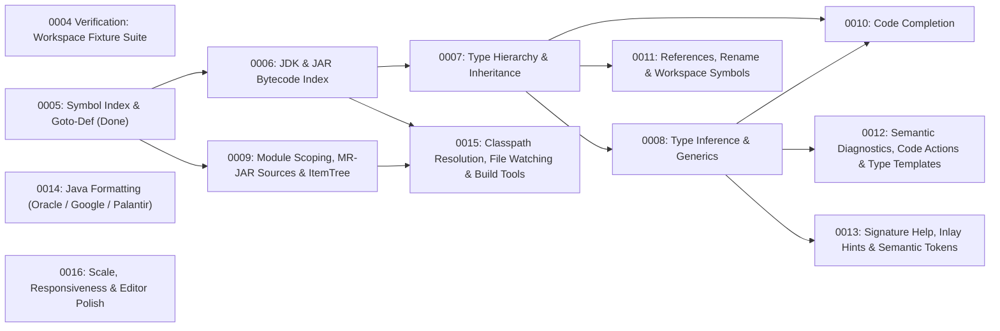

# `java-analyzer` Roadmap

## Where We Are Today (Completed)

| Spec | Milestone | Status |
|------|-----------|--------|
| **0001** | 4-layer architecture (`syntax` → `hir` → `ide` → `java-analyzer`), `rowan` + `salsa` bootstrap | Done |
| **0002 / 0003** | Lossless Java lexer & parser (Java 8 through latest JDK — currently 27, tracking new releases & preview JEPs), feature-gated language levels, OpenJDK/jtreg conformance runner (`xtask`) | Done (ongoing) |
| **0004** | Lightweight workspace & project model (zero-config roots, `package-info.java`, `META-INF/`, 3-tier config, Maven/Gradle/Ant+Ivy, `configure` & `inspect` CLIs) | Done (follow-ups in [0004-workspace-model-followups.md](plans/0004-workspace-model-followups.md)) |
| **0005** | Cross-file symbol indexing (`DefDatabase`), lexical/import/member name resolution, `textDocument/definition`, semantic `hover` | Done |
| **Clients** | Zed, VSCode, Neovim, and Helix client configs (`editors/`) | Done |

---

## Dependency Overview

---

## Near-Term Verification Track

- **Spec 0004 Workspace Auto-Detection Test Suite** *(Done in `crates/java-analyzer/tests/workspace_fixtures.rs`)*
  - Checked-in fixture suite of representative test Java projects (Maven single- and multi-module, Gradle, Ant+Ivy, JPMS multi-module, zero-config/flat, JBang/compact scripts, and intentional build-tool / release / package-mismatch conflict cases) verifying that `probe_workspace` infers the exact expected modules, `main`/`test` `sources` & `resources` roots, `META-INF/` indicators, `requires` edges, and conflicts.
- **Release Binaries & Nightly Real-World Corpus Job** *(Planned in [nightly-corpus-and-release-binaries.md](plans/nightly-corpus-and-release-binaries.md))*
  - Publish prebuilt `java-analyzer` binaries (releases + nightly) and run a scheduled nightly CI job executing `java-analyzer inspect --json` against a prescribed corpus of real-world Java repositories to guard against structure-detection and parse-health regressions.

---

## Phase 1: Core Semantic Engine (`hir`)
*Goal: Understand real-world Java codebases (JDK standard library, JAR dependencies, inheritance, generics, and `var`).*

- **Spec 0006 — JDK & JAR Binary Classpath Indexing (`.class` / `.jar` / `jimage` / JEP 238 MR-JAR)**
  - Pure-Rust `.class` bytecode stub reader (parsing class/interface/enum/record/annotation signatures, supertypes, fields, methods, generic signatures, and parameter names — no running JVM required).
  - **JEP 238 Multi-Release JARs**: detect `Multi-Release: true` in `META-INF/MANIFEST.MF` and overlay `META-INF/versions/<N>/` entries for `9 <= N <= active_release` in ascending version order on top of base classes (including versioned `module-info.class`).
  - Index the active JDK (`lib/modules` / `jmods`), implicit `java.lang.*` imports, and workspace `.jar` dependencies.
  - Unlocks hover, member lookup, and goto-definition (to JDK `src.zip` or synthesized stub view) for `Object`, `String`, `List`, `Map`, `Optional`, etc.
- **Spec 0007 — Type Hierarchy, Inheritance & `super` Resolution**
  - Resolve `extends`, `implements`, and `permits` clauses across both workspace sources and indexed JDK/JAR types (from Spec 0006).
  - Inherited field/method/nested-type lookup, `super.member` / `super(...)`, interface `default`/`static` methods, and `@Override` matching.
  - LSP: `textDocument/implementation`, `textDocument/typeDefinition`.
- **Spec 0008 — Expression Type Inference & Generics**
  - `var` local variable inference, chained calls (`foo.bar().baz()`), array/field/literal/ternary/switch-expression typing.
  - Generic type-argument substitution (`List<User>.get(0)` → `User`), lambda parameter type inference, and type-based overload resolution.
- **Spec 0009 — Module-Scoped Visibility, Multi-Release Source Roots (JEP 238) & Position-Independent `ItemTree`**
  - Enforce Spec 0004 `ModuleId`, `main`/`test` scopes, and JPMS `requires`/`exports` boundaries in `DefDatabase`.
  - Support per-source-root release overrides for Maven/Gradle multi-release JAR source trees (e.g. `src/main/java9`, `src/main/java17`, `src/main/java21`, `src/main/versions/<N>`), including versioned class/module-info overlays.
  - Introduce position-independent `ItemTree` / AST-IDs so line edits inside a method body never invalidate downstream files in Salsa.

---

## Phase 2: Daily-Driver IDE Features (`ide` + `java-analyzer` + `editors/`)
*Goal: Make `java-analyzer` genuinely productive for day-to-day Java editing.*

- **Spec 0010 — Code Completion (`textDocument/completion`)**
  - Dot completion (`receiver.`) with inherited & generic-substituted members.
  - Scope completion (locals, parameters, fields, methods, types in scope).
  - Workspace & JDK type completion with automatic `import` insertion (`additionalTextEdits`), plus keyword/snippet completions.
- **Spec 0011 — Find References, Workspace Symbols & Rename**
  - `textDocument/references`, `textDocument/documentHighlight`, `workspace/symbol`.
  - Safe `textDocument/prepareRename` and `textDocument/rename` across files (respecting shadowing and overrides).
- **Spec 0012 — Semantic Diagnostics, Quick-Fix Code Actions & New Type Templates**
  - Semantic diagnostics: unresolved types/symbols, unused imports/locals, unimplemented abstract methods, invalid `@Override`.
  - `textDocument/codeAction`: auto-import, organize/remove unused imports, implement missing methods, plus the deferred Spec 0004 quick-fixes (package mismatch & config/version conflict resolution).
  - **New Java File / Type Templates** (simplified IntelliJ "New Java Class" flow): generate `class`, `interface`, `record`, `enum`, `@interface`, `package-info.java`, `module-info.java`, or compact source file with `package` automatically inferred from the enclosing `SourceRoot`, exposed via LSP (`workspace/executeCommand` / `workspace/willCreateFiles`) and editor client pickers (Zed, VSCode, Neovim).
- **Spec 0013 — Signature Help, Inlay Hints & Semantic Tokens**
  - `textDocument/signatureHelp` (active parameter tracking across overloads).
  - `textDocument/inlayHint` (inferred `var` types, chained types, parameter names).
  - `textDocument/semanticTokens/full` and `textDocument/foldingRange`.
- **Spec 0014 — Java Formatting (`crates/java-fmt`, `crates/java-fmt-cli` & LSP `formatting` / `rangeFormatting`)**
  - Pure, sans-IO lossless CST-driven formatter library (`crates/java-fmt`, depending only on `syntax`) embedded into `ide` for LSP formatting and usable in Rust/WASM/FFI integrations.
  - Standalone multi-binary CLI crate (`crates/java-fmt-cli`) shipping canonical `java-fmt` alongside dedicated flag-compatible drop-in binaries (`google-java-format`, `palantir-java-format`) for `jj fix`, `git` pre-commit/CI, Gradle/Maven Spotless, and standalone editor save-hooks (Zed, Neovim, Helix, Emacs, VS Code, IntelliJ).
  - Built-in named code styles first: **`oracle`** (Oracle official Java code conventions), **`google`** (Google Java Style + AOSP), and **`palantir`** (Palantir Java Format), selectable via `.java-analyzer.toml` / `javafmt.toml` / CLI flags, with fine-grained options as a follow-up layer.

---

## Phase 3: Ecosystem, Build Tools & Scale (`java-analyzer` + `editors/`)
*Goal: Smooth experience on large multi-module repositories and diverse build systems.*

- **Spec 0015 — Dependency Resolution, File Watching & Build Tool Parity**
  - Resolve Maven/Ivy/Gradle/Git coordinates (and external parent POMs) from local caches (`~/.m2`, `~/.gradle`, Coursier) and `classpath_command`.
  - Live `workspace/didChangeWatchedFiles` re-probing when manifests, `.java-analyzer.toml`, or `package-info.java` change on disk.
  - Remaining Spec 0004 follow-ups: Bazel, Mill, sbt, Elide, and JBang manifest introspectors, plus the inline readline/widget TUI for `java-analyzer configure`.
- **Spec 0016 — Scale, Responsiveness & Editor Polish**
  - `TextDocumentSyncKind::INCREMENTAL`, request cancellation, background indexing `$/progress` notifications.
  - Packaging & polish for Zed, VSCode, and Neovim clients.
- **Spec 0019 — Statically Generated GitHub Pages Site & Documentation** *(Accepted in [0019-github-pages-site-and-documentation.md](specs/0019-github-pages-site-and-documentation.md))*
  - Astro + Starlight static site with a 3-pillar landing page (what it is, why consider it, how to start using it), [Diátaxis](https://diataxis.fr/) end-user documentation (`Tutorials`, `How-to Guides`, `Reference`, `Explanation`), a dedicated `Contributors` section, auto-synced canonical reports/specs (`CONFORMANCE.md`, `BENCHMARKS.md`, interactive Vega-Lite `/benchmarks/report/`, `ROADMAP.md`, `docs/specs/*.md`), and GitHub Actions Pages deployment.
