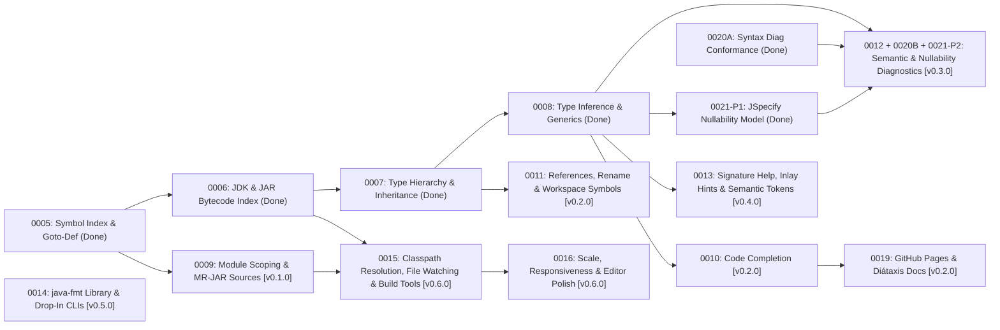

# `java-analyzer` Roadmap

## Pre-1.0 Versioning & Stability Policy

Prior to `v1.0.0`, minor `0.x.0` milestones track cohesive user-facing capability tiers. Until `v1.0.0` readiness:
- **Clean evolution over legacy shims:** `.java-analyzer.toml`, `javafmt.toml`, and CLI schemas may evolve cleanly across `0.x` releases without carrying backwards-compatibility shims; formal config/CLI backwards-compatibility guarantees begin at **`v1.0.0`**.
- **Independent formatter packaging:** Because `crates/java-fmt` depends solely on `crates/syntax` (zero Salsa/HIR coupling), `java-fmt` and its drop-in CLI binaries ship in lockstep with workspace releases starting in `v0.5.0` (or earlier if pulled forward).

| Milestone | Theme | Specs & Deliverables | Status |
|-----------|-------|----------------------|--------|
| **`v0.1.0`** | **Core Semantic Engine & Fast Navigation** | **0001–0009** (done), **0017–0018** (done), **0020 Phase A** (done), **0021 Phase 1** (done), **0022** *(release & publishing pipeline)*, Zed/VSCode/Neovim/Helix clients | In progress (`0022` final step) |
| **`v0.2.0`** | **Authoring Essentials & Public Docs Portal** | **0010** (Code Completion + auto-import), **0011** (References, Highlight, Workspace Symbols, Rename), **0019** (Astro/Starlight GitHub Pages site & Diátaxis docs) | Planned |
| **`v0.3.0`** | **Live Typechecking, Null-Safety & Quick-Fixes** | **0012** (Semantic Diagnostics, Quick-Fix Code Actions, New Java Type Templates), **0020 Phase B** (Semantic Diagnostic Conformance), **0021 Phase 2** (Null-Safety Inspections) | Planned |
| **`v0.4.0`** | **Rich Editor Ergonomics** | **0013** (`signatureHelp`, `inlayHint` for `var`/chains/params, `semanticTokens/full`, `foldingRange`) | Planned |
| **`v0.5.0`** | **Native Java Formatter (`java-fmt`)** | **0014** (`crates/java-fmt` pure CST library + `crates/java-fmt-cli` shipping `java-fmt`, `google-java-format`, `palantir-java-format` entrypoints + LSP `formatting` / `rangeFormatting`) | Planned |
| **`v0.6.0`** | **Build Ecosystem, Watching & Scale** | **0015** (Maven/Gradle/Ivy/Coursier cache resolution, `didChangeWatchedFiles`, Bazel/Mill/sbt/JBang, `usage-config` unification), **0016** (Incremental sync, cancellation, `$/progress`, client packaging) | Planned |
| **`v1.0.0`** | **Production Readiness & Stability Guarantee** | Corpus burn-in, 9-repo benchmark sign-off, published editor marketplace extensions, and **config/CLI backwards-compatibility guarantee** | Target |

---

## Where We Are Today (Completed on `main`)

| Spec | Milestone | Status |
|------|-----------|--------|
| **0001** | 4-layer architecture (`syntax` → `hir` → `ide` → `java-analyzer`), `rowan` + `salsa` bootstrap | Done |
| **0002 / 0003** | Lossless Java lexer & parser (Java 8 through latest JDK — currently 27, tracking new releases & preview JEPs), feature-gated language levels, OpenJDK/jtreg conformance runner (`xtask`) | Done (ongoing) |
| **0004** | Lightweight workspace & project model (zero-config roots, `package-info.java`, `META-INF/`, 3-tier config, Maven/Gradle/Ant+Ivy, `configure` & `inspect` CLIs, fixture suite) | Done (follow-ups in [0004-workspace-model-followups.md](plans/0004-workspace-model-followups.md)) |
| **0005** | Cross-file symbol indexing (`DefDatabase`), position-independent `FileItemTree`/`AstIdMap`, lexical/import/member name resolution, `textDocument/definition`, semantic `hover` | Done |
| **0006** | Pure-Rust JDK (`jimage` / `ct.sym` / `jmods` / `rt.jar`) & JAR/MR-JAR (JEP 238) binary classpath indexing (`ristretto_classfile`), on-demand `src.zip`/Javadoc attachment & stub materialization | Done |
| **0007** | Cross-workspace & binary type hierarchy (`extends` / `implements` / `permits`), inherited member & `super` resolution, `textDocument/implementation`, `textDocument/typeDefinition`, `typeHierarchy/*` | Done |
| **0008** | Structured `Ty` IR (with Valhalla `TypeIdentity` & `Nullability` hooks), generic substitution across source & binary supertypes, bidirectional expression/`var`/lambda SAM inference, JLS §15.12.2 overload resolution | Done |
| **0009** | Module-scoped symbol visibility (`ModuleId`, `Main`/`Test` isolation, transitive `exported` edges, JPMS `requires`/`exports`) & JEP 238 Multi-Release source-root overlays (`src/main/java<N>`) | Done |
| **0017** | Deterministic `cargo xtask report` conformance report generator (`CONFORMANCE.md`) | Done |
| **0018** | Reproducible 9-repo × 4-server LSP benchmark suite (`cargo xtask bench` / `bench-plot`), light/dark SVG charts & interactive Vega-Lite HTML report (`BENCHMARKS.md`) | Done |
| **0020 (Phase A)** | Rich `ide::Diagnostic` codes/related-info/help, Tier 1 `rustc`-style ASCII caret snapshots + UX invariants, Tier 2 `cargo xtask diag-conformance --phase syntax` | Done (Phase B in `v0.3.0`) |
| **0021 (Phase 1)** | Source-agnostic JSpecify 1.0 & third-party nullability (`NullnessScope`, `NullabilitySource`), JLS §9.7.4 placement, binary `RuntimeVisible*`/`RuntimeInvisible*` decoding, concise `User?`/`User!` hover | Done (Phase 2 in `v0.3.0`) |
| **CLI & Clients** | Unified `usage-rs` v7 CLI (`#[usage(run)]` dispatch, `.usage.kdl` specs, `completion <bash\|zsh\|fish>`), Zed, VSCode, Neovim, and Helix client configs (`editors/`) | Done |

---

## Dependency Overview

---

## Release Infrastructure Track (`[v0.1.0]`)

- **Spec 0022 — Release Process, Packaging & Publishing** *(Accepted in [0022-release-process-and-publishing.md](specs/0022-release-process-and-publishing.md))*
  - Cross-platform GitHub Releases (`java-analyzer/java-analyzer`), `cargo xtask release-prep`, `mise` & `cargo-binstall` support, auto-downloading/auto-upgrading Zed & universal VS Code extensions, and nightly real-world corpus CI.

---

## Phase 1: Core Semantic Engine (`hir`) — Target: `v0.1.0`
*Goal: Understand real-world Java codebases (JDK standard library, JAR dependencies, inheritance, generics, `var`, nullability, and module boundaries).*

- **Spec 0006 — JDK & JAR Binary Classpath Indexing** *(Done)*
- **Spec 0007 — Type Hierarchy, Inheritance & `super` Resolution** *(Done)*
- **Spec 0008 — Expression Type Inference & Generics** *(Done)*
- **Spec 0021 (Phase 1) — Nullability & Null-Restricted Types Model & Hover** *(Done)*
- **Spec 0009 — Module-Scoped Visibility & Multi-Release Source Roots (JEP 238)** *(Done)*

---

## Phase 2: Daily-Driver IDE Features (`ide` + `java-analyzer` + `editors/`) — Targets: `v0.2.0` – `v0.5.0`
*Goal: Make `java-analyzer` genuinely productive for day-to-day Java editing.*

- **Spec 0010 — Code Completion (`textDocument/completion`)** `[v0.2.0]`
  - Dot completion (`receiver.`) with inherited, generic-substituted, and nullability-annotated members.
  - Scope completion (locals, parameters, fields, methods, types in scope).
  - Workspace & JDK type completion with automatic `import` insertion (`additionalTextEdits`), plus keyword/snippet completions.
- **Spec 0011 — Find References, Workspace Symbols & Rename** `[v0.2.0]`
  - `textDocument/references`, `textDocument/documentHighlight`, `workspace/symbol`.
  - Safe `textDocument/prepareRename` and `textDocument/rename` across files (respecting shadowing and overrides).
- **Spec 0019 — Statically Generated GitHub Pages Site & Documentation** `[v0.2.0]` *(Accepted in [0019-github-pages-site-and-documentation.md](specs/0019-github-pages-site-and-documentation.md))*
  - Astro + Starlight static site with a 3-pillar landing page (what it is, why consider it, how to start using it), [Diátaxis](https://diataxis.fr/) end-user documentation (`Tutorials`, `How-to Guides`, `Reference`, `Explanation`), a dedicated `Contributors` section, auto-synced canonical reports/specs (`CONFORMANCE.md`, `BENCHMARKS.md`, interactive Vega-Lite `/benchmarks/report/`, `ROADMAP.md`, `docs/specs/*.md`), and GitHub Actions Pages deployment.
- **Spec 0012 (+ Spec 0020 Phase B & Spec 0021 Phase 2) — Semantic & Nullability Diagnostics, Quick-Fixes & Type Templates** `[v0.3.0]`
  - Semantic diagnostics: unresolved types/symbols, type mismatches, unused imports/locals, unimplemented abstract methods, invalid `@Override` (`javac`-familiar headlines + `rustc`-style spans, related info, and `help:` hints, verified by **Spec 0020 Phase B** Tier 1 snapshots & Tier 2 `diag-conformance --phase all`).
  - **Spec 0021 Phase 2** null-safety inspections: nullable dereference, null return in `@NullMarked` scope, nullable argument to non-null parameter, and override nullability mismatches.
  - `textDocument/codeAction`: auto-import, organize/remove unused imports, implement missing methods, plus Spec 0004 package-mismatch & config-conflict quick-fixes.
  - **New Java File / Type Templates**: generate `class`, `interface`, `record`, `enum`, `@interface`, `package-info.java`, `module-info.java`, or compact source file with `package` inferred from the enclosing `SourceRoot`.
- **Spec 0013 — Signature Help, Inlay Hints & Semantic Tokens** `[v0.4.0]`
  - `textDocument/signatureHelp` (active parameter tracking across overloads).
  - `textDocument/inlayHint` (inferred `var` types, chained types, parameter names).
  - `textDocument/semanticTokens/full` and `textDocument/foldingRange`.
- **Spec 0014 — Java Formatting (`crates/java-fmt`, `crates/java-fmt-cli` & LSP `formatting` / `rangeFormatting`)** `[v0.5.0]`
  - Pure, sans-IO lossless CST-driven formatter library (`crates/java-fmt`, depending only on `syntax`) embedded into `ide` for LSP formatting and usable in Rust/WASM/FFI integrations.
  - Standalone multi-binary CLI crate (`crates/java-fmt-cli`, using `usage-rs` `multicall` + `#[usage(run)]`) shipping canonical `java-fmt` alongside dedicated flag-compatible drop-in binaries (`google-java-format`, `palantir-java-format`) for `jj fix`, `git` pre-commit/CI, Gradle/Maven Spotless, and standalone editor save-hooks (Zed, Neovim, Helix, Emacs, VS Code, IntelliJ).
  - Built-in named code styles first: **`oracle`** (Oracle official Java code conventions), **`google`** (Google Java Style + AOSP), and **`palantir`** (Palantir Java Format), selectable via `.java-analyzer.toml` / `javafmt.toml` / CLI flags, with fine-grained options as a follow-up layer.

---

## Phase 3: Ecosystem, Build Tools & Scale (`java-analyzer` + `editors/`) — Target: `v0.6.0` → `v1.0.0`
*Goal: Smooth experience on large multi-module repositories, diverse build systems, and `1.0` stability.*

- **Spec 0015 — Dependency Resolution, File Watching & Build Tool Parity** `[v0.6.0]`
  - Resolve Maven/Ivy/Gradle/Git coordinates (and external parent POMs) from local caches (`~/.m2`, `~/.gradle`, Coursier) and `classpath_command`.
  - Live `workspace/didChangeWatchedFiles` re-probing when manifests, `.java-analyzer.toml`, or `package-info.java` change on disk.
  - Unify `.java-analyzer.toml`, CLI flags, and env vars via `usage-config` ([usage-config-followups.md](plans/usage-config-followups.md)).
  - Remaining Spec 0004 follow-ups: Bazel, Mill, sbt, Elide, and JBang manifest introspectors, plus the inline readline/widget TUI for `java-analyzer configure`.
- **Spec 0016 — Scale, Responsiveness & Editor Polish** `[v0.6.0]`
  - `TextDocumentSyncKind::INCREMENTAL`, request cancellation, background indexing `$/progress` notifications.
  - Packaging & polish for Zed, VSCode, Neovim, and Helix clients ahead of **`v1.0.0`**.
  - Optional Go-style transparent, strictly opt-in feature & latency telemetry ([usage-stats-and-opt-in-telemetry.md](plans/usage-stats-and-opt-in-telemetry.md)).
